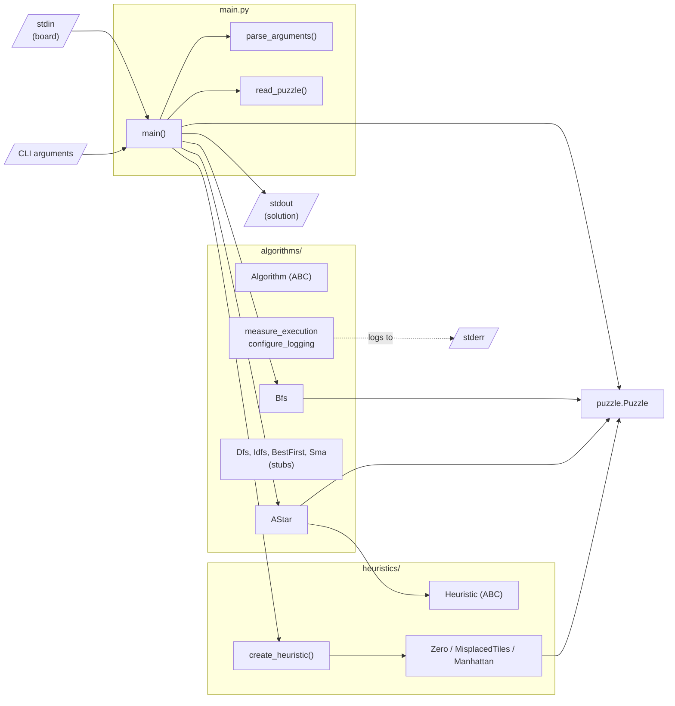
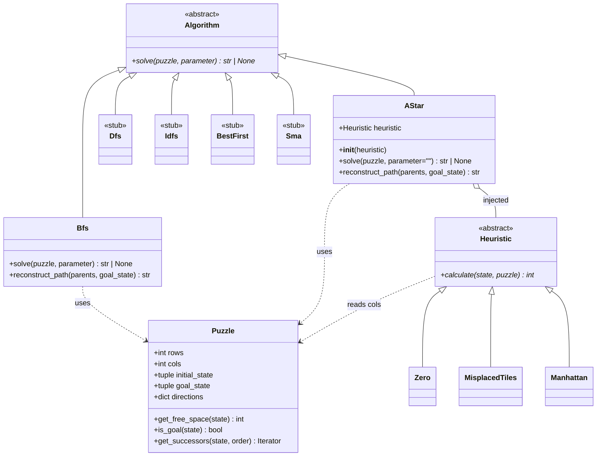
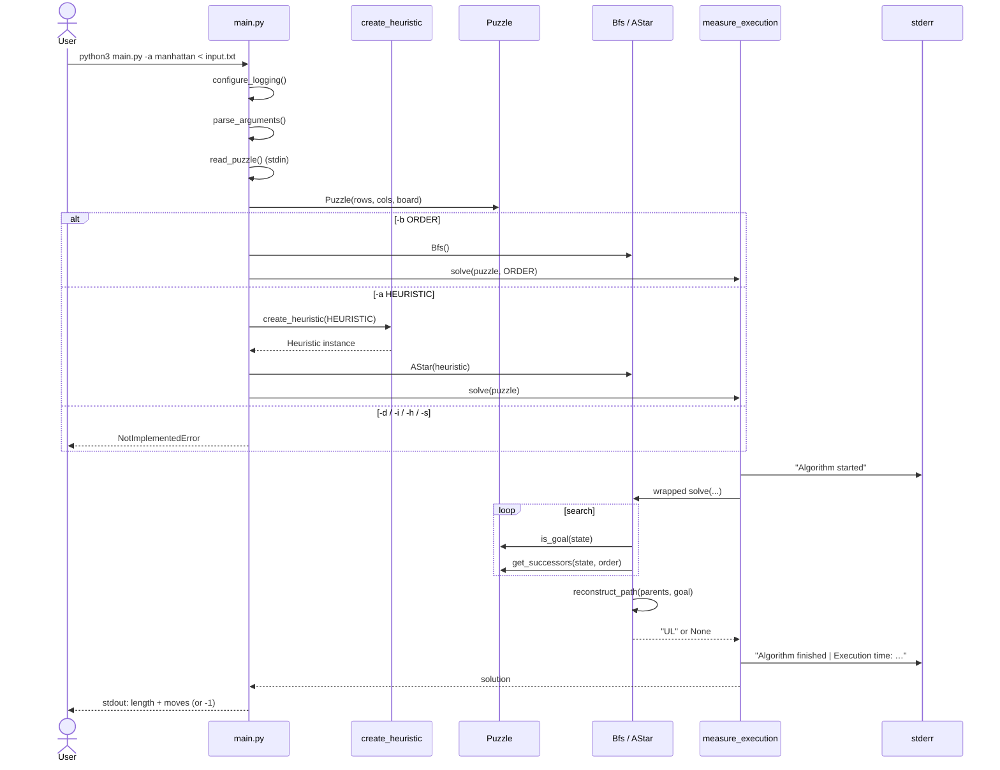

# Architecture

## Overview

The solver is a small layered command-line application. It has four parts:

| Layer | Module(s) | Responsibility |
|---|---|---|
| Entry point / composition root | `main.py` | Parse arguments, read input, build objects, pick the algorithm, print output |
| Problem model | `puzzle.py` | State encoding, goal test, successor function |
| Search strategies | `algorithms/` | Search algorithms behind the `Algorithm` interface |
| Heuristics | `heuristics/` | State evaluators behind the `Heuristic` interface, plus a factory |

The algorithms depend on the `Puzzle` model and, for informed search, on the `Heuristic` abstraction. Concrete heuristics depend only on `Puzzle`. No module depends on `main.py`.

## High-level component architecture



## Module responsibilities

### `main.py`

- `parse_arguments()` builds an `argparse.ArgumentParser` with `add_help=False`, a manual `--help` option, and a **required mutually exclusive group** of the six algorithm options.
- `read_puzzle()` reads `rows cols` and then `rows` lines of integers from standard input. It returns `(rows, cols, board)`, where `board` is a `list[list[int]]`.
- `main()` is the composition root. It calls `configure_logging()`, parses the arguments, reads the puzzle, creates a `Puzzle`, selects and runs the algorithm, and prints the result.

### `puzzle.py` — `Puzzle`

| Member | Description |
|---|---|
| `rows`, `cols` | Board dimensions |
| `initial_state` | Flattened, row-major `tuple[int, ...]` |
| `goal_state` | `(1, 2, …, rows·cols−1, 0)` |
| `directions` | Maps a move letter to the offset of the moving **tile** relative to the empty cell |
| `get_free_space(state)` | Index of `0` in the state |
| `is_goal(state)` | `state == goal_state` |
| `get_successors(state, order="LURD")` | Generator of `(move, next_state)` pairs. Validates `order` and randomizes it if it starts with `R` |

Details are in [puzzle-representation.md](puzzle-representation.md).

### `algorithms/`

| File | Content |
|---|---|
| `algorithm.py` | `Algorithm` ABC, `DEBUG` flag, `configure_logging()`, `measure_execution` decorator |
| `bfs.py` | `Bfs`, the [breadth-first search](algorithms/bfs.md) |
| `astar.py` | `AStar`, the [A\* search](algorithms/astar.md) |
| `dfs.py`, `idfs.py`, `best_first.py`, `sma.py` | Placeholder classes `Dfs`, `Idfs`, `BestFirst`, `Sma` |
| `__init__.py` | Re-exports all of the classes above |

The placeholder classes declare `def __init__():` and `def solve():` **without `self`**, and `solve` is not decorated. Importing them works, but calling `Dfs()` raises `TypeError`. They mark where future work goes and are not usable implementations.

### `heuristics/`

| File | Content |
|---|---|
| `heuristic.py` | `Heuristic` ABC with the abstract method `calculate(state, puzzle) -> int` |
| `zero.py`, `misplaced_tiles.py`, `manhattan.py` | Concrete heuristics |
| `factory.py` | `create_heuristic(heuristic_id)`: maps a name to a class and returns an instance |
| `__init__.py` | Re-exports `Heuristic`, `Zero`, `MisplacedTiles`, `Manhattan` (not the factory) |

## Class relationships



### Abstract base classes

- **`Algorithm`** (`abc.ABC`) defines one contract: `solve(puzzle, parameter) -> str | None`. The return value is the move string (`""` if the initial state is already the goal) or `None` if no solution exists. `parameter` holds the movement order for uninformed algorithms. `AStar` declares it with the default `""` and ignores it.
- **`Heuristic`** (`abc.ABC`) defines `calculate(state, puzzle) -> int`. It receives the whole `Puzzle`, so a heuristic can read the board geometry (`puzzle.cols`) without being bound to one board size at construction time.

### Dependency injection for heuristic selection

`AStar` does not choose its heuristic. It receives one through the constructor:

```python
heuristic = create_heuristic(args.astar)   # e.g. "manhattan" -> Manhattan()
algorithm = AStar(heuristic)
```

`AStar` depends only on the `Heuristic` abstraction (Dependency Inversion). New heuristics can be added without changing `AStar` (Open/Closed). The same instance could be passed to a future `BestFirst` or `Sma`. The commented-out branches in `main.py` already show this pattern.

## Execution flow



## State management and data flow

- **States** are immutable `tuple[int, ...]` objects, so they can be used as keys in `set` and `dict`.
- `Puzzle` is **stateless during search**: it stores only the configuration (dimensions, initial and goal state, direction table). Each `solve()` call keeps all search data in local variables:

| Structure | `Bfs` | `AStar` |
|---|---|---|
| Frontier | `deque` (FIFO) | `list` used as a binary heap (`heapq`) |
| Discovered states | `visited: set` | keys of `g_score: dict` |
| Path cost | implicit (BFS level) | `g_score[state]` |
| Back-pointers | `parents: dict[state, (parent, move)]` | same |

Because nothing is stored on the instance, the same `Bfs` or `AStar` object can safely solve several puzzles in a row.

## Solution reconstruction

Both algorithms store `parents[state] = (parent_state, move)`. The initial state is stored as `(None, None)`. `reconstruct_path(parents, goal_state)` follows the back-pointers from the goal to the root, collects the moves, reverses them and joins them into a string. `Bfs` and `AStar` contain identical copies of this method. It could be moved into `Algorithm` in the future (see [development.md](development.md#design-principles)).

## Logging and execution-time measurement

Defined in [`algorithms/algorithm.py`](../algorithms/algorithm.py):

- `DEBUG = True` is a module-level switch.
- `configure_logging()` calls `logging.basicConfig` with level `INFO` (or `CRITICAL` if `DEBUG` is false), the format `[%(levelname)s] %(message)s` and `stream=sys.stderr`.
- `@measure_execution` wraps `solve`. It gets a logger named after the class (`"Bfs"`, `"AStar"`), records `time.perf_counter()`, logs `Algorithm started`, and in a `finally` block logs `Algorithm finished | Execution time: %.6f s`. The `finally` block ensures that the time is logged even when `solve` raises an exception (for example an invalid movement order).

The measured time covers only the `solve` call. Input parsing and object construction are not included. The time is logged but not returned or written to standard output.

## Error handling

There is no dedicated error-handling layer. Errors come from:

- `argparse` (missing or conflicting options): usage message, exit code 2.
- `create_heuristic`: `ValueError` for unknown IDs.
- `Puzzle.get_successors`: `ValueError` for invalid movement orders.
- `main()`: `NotImplementedError` for algorithms without an implementation.
- `read_puzzle`: `ValueError` from `int()` conversion or `EOFError` for malformed or short input.

None of these is caught, so they end the program with a traceback on standard error. See [cli-reference.md](cli-reference.md#behavior-and-error-handling).
