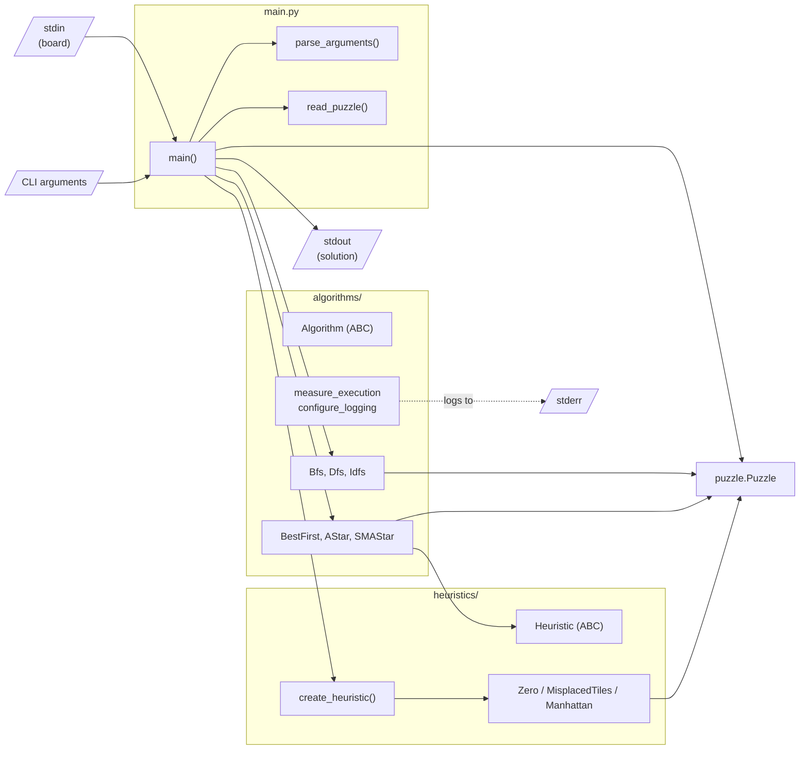
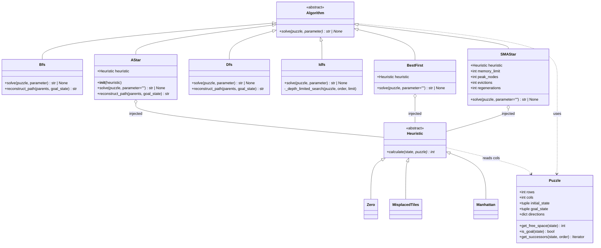
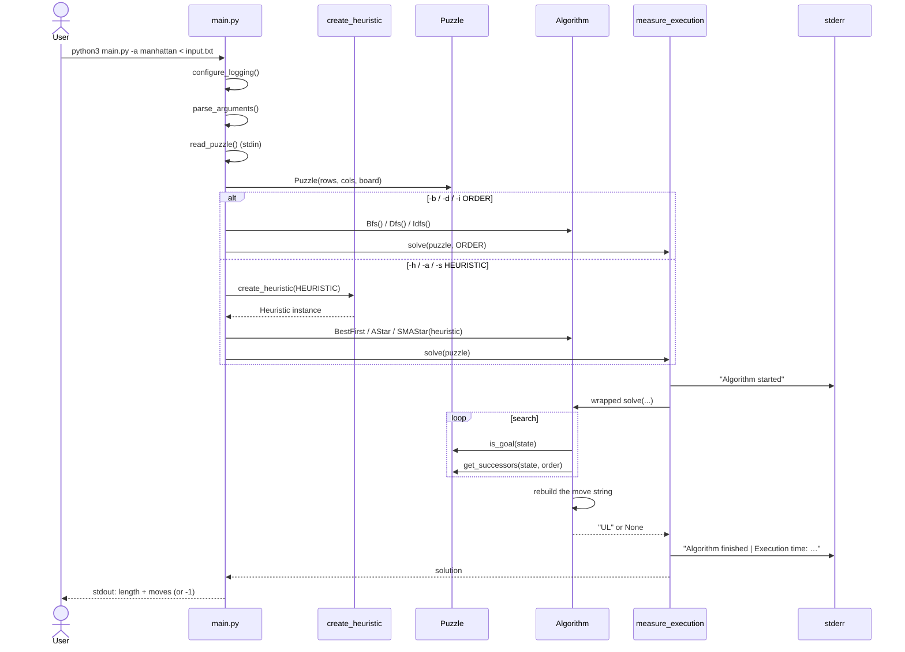

# Architecture

## Overview

The solver is a small layered command-line application. It has four core parts, plus two standalone tools:

| Layer | Module(s) | Responsibility |
|---|---|---|
| Entry point / composition root | `main.py` | Parse arguments, read input, build objects, pick the algorithm, print output |
| Problem model | `puzzle.py` | State encoding, goal test, successor function |
| Search strategies | `algorithms/` | Search algorithms behind the `Algorithm` interface |
| Heuristics | `heuristics/` | State evaluators behind the `Heuristic` interface, plus a factory |
| Viewer (tool) | `viewer/` | Tkinter GUI that replays a saved solution step by step |
| Benchmark (tool) | `benchmark/` | Runs `main.py` in limited subprocesses and records results in CSV files ([benchmark.md](benchmark.md)) |

The algorithms depend on the `Puzzle` model and, for informed search, on the `Heuristic` abstraction. Concrete heuristics depend only on `Puzzle`. Of the core modules, none depends on `main.py`. The benchmark runs `main.main()` in a child process and uses `Puzzle` to verify solutions. The viewer is independent of the solver: it reads a puzzle file and a saved solution file.

## High-level component architecture



## Module responsibilities

### `main.py`

- `parse_arguments()` builds an `argparse.ArgumentParser` with `add_help=False`, a manual `--help` option, and a **required mutually exclusive group** of the six algorithm options.
- `read_puzzle()` reads `rows cols` and then `rows` lines of integers from standard input. It returns `(rows, cols, board)`, where `board` is a `list[list[int]]`.
- `main()` is the composition root. It calls `configure_logging()`, parses the arguments, reads the puzzle, creates a `Puzzle`, selects and runs the algorithm, and prints the result.

### `puzzle.py` — `Puzzle`

| Member | Description |
|---|---|
| `rows`, `cols` | Board dimensions |
| `initial_state` | Flattened, row-major `tuple[int, ...]` |
| `goal_state` | `(1, 2, …, rows·cols−1, 0)` |
| `directions` | Maps a move letter to the offset of the moving **tile** relative to the empty cell |
| `get_free_space(state)` | Index of `0` in the state |
| `is_goal(state)` | `state == goal_state` |
| `get_successors(state, order="LURD")` | Generator of `(move, next_state)` pairs. Validates `order` and randomizes it if it starts with `R` |

Details are in [puzzle-representation.md](puzzle-representation.md).

### `algorithms/`

| File | Content |
|---|---|
| `algorithm.py` | `Algorithm` ABC, `DEBUG` flag, `configure_logging()`, `measure_execution` decorator |
| `bfs.py` | `Bfs`, the [breadth-first search](algorithms/bfs.md) |
| `dfs.py` | `Dfs`, the [depth-first search](algorithms/dfs.md) |
| `idfs.py` | `Idfs`, the [iterative deepening DFS](algorithms/idfs.md) |
| `best_first.py` | `BestFirst`, the [greedy best-first search](algorithms/best-first.md) |
| `astar.py` | `AStar`, the [A\* search](algorithms/astar.md) |
| `sma.py` | `SMAStar`, the [SMA\* search](algorithms/sma.md), with its helper classes `_Node` and `_Branch` |
| `__init__.py` | Re-exports all of the classes above |

### `heuristics/`

| File | Content |
|---|---|
| `heuristic.py` | `Heuristic` ABC with the abstract method `calculate(state, puzzle) -> int` |
| `zero.py`, `misplaced_tiles.py`, `manhattan.py` | Concrete heuristics |
| `factory.py` | `create_heuristic(heuristic_id)`: maps a name to a class and returns an instance |
| `__init__.py` | Re-exports `Heuristic`, `Zero`, `MisplacedTiles`, `Manhattan` (not the factory) |

### `viewer/`

| File | Content |
|---|---|
| `app.py` | `load_puzzle()`, `load_solution()` (both validate their input), the `PuzzleViewer` Tkinter window and `main()` (`python3 -m viewer.app PUZZLE SOLUTION`) |
| `board.py` | `PuzzleBoard`: precomputes the board after every move of the solution |

### `benchmark/`

| File | Content |
|---|---|
| `run.py` | The benchmark runner: builds the configuration list, runs each one in a resource-limited child process, verifies the solution and writes a CSV row |
| `__main__.py` | Entry point for `python3 -m benchmark` |
| `generate_boards.py` | Generates the scrambled 4×4 board set |

Details are in [benchmark.md](benchmark.md).

## Class relationships



### Abstract base classes

- **`Algorithm`** (`abc.ABC`) defines one contract: `solve(puzzle, parameter) -> str | None`. The return value is the move string (`""` if the initial state is already the goal) or `None` if no solution exists. `parameter` holds the movement order for uninformed algorithms. `BestFirst`, `AStar` and `SMAStar` declare it with the default `""` and ignore it.
- **`Heuristic`** (`abc.ABC`) defines `calculate(state, puzzle) -> int`. It receives the whole `Puzzle`, so a heuristic can read the board geometry (`puzzle.cols`) without being bound to one board size at construction time.

### Dependency injection for heuristic selection

The informed algorithms (`BestFirst`, `AStar`, `SMAStar`) do not choose their heuristic. They receive one through the constructor:

```python
heuristic = create_heuristic(args.astar)   # e.g. "manhattan" -> Manhattan()
algorithm = AStar(heuristic)
```

They depend only on the `Heuristic` abstraction (Dependency Inversion). New heuristics can be added without changing any algorithm (Open/Closed).

## Execution flow



## State management and data flow

- **States** are immutable `tuple[int, ...]` objects, so they can be used as keys in `set` and `dict`.
- `Puzzle` is **stateless during search**: it stores only the configuration (dimensions, initial and goal state, direction table). Each `solve()` call keeps all search data in local variables:

| Structure | `Bfs` | `Dfs` | `Idfs` | `BestFirst` | `AStar` | `SMAStar` |
|---|---|---|---|---|---|---|
| Frontier | `deque` (FIFO) | list of `(state, successor iterator)` | same as `Dfs`, per iteration | `heapq` on `(h, counter, state)` | `heapq` on `(f, counter, state)` | tree of `_Node` / `_Branch` |
| Discovered states | `visited: set` | `visited: set` | `on_path: set` (current path only) | keys of `parents` | keys of `g_score` | `resident: dict` (bounded) |
| Path | `parents` back-pointers | `parents` back-pointers | `moves: list` | `parents` back-pointers | `parents` back-pointers | `parent` links in `_Node` |

Because search data is not stored on the instance, the same algorithm object can safely solve several puzzles in a row. The only exception is `SMAStar`, which keeps the statistics `peak_nodes`, `evictions` and `regenerations` from its last run; they are reset at the start of every `solve`.

## Solution reconstruction

`Bfs`, `Dfs` and `AStar` store `parents[state] = (parent_state, move)`, with the initial state stored as `(None, None)`. Their `reconstruct_path(parents, goal_state)` follows the back-pointers from the goal to the root, collects the moves, reverses them and joins them into a string. The three classes contain identical copies of this method. `BestFirst` has its own `_reconstruct_path` for a `parents` map in which the root is stored as `None`. `Idfs` keeps the current path in a list and joins it directly, and `SMAStar` follows the `parent` links of its tree nodes. The shared method could be moved into `Algorithm` in the future (see [development.md](development.md#design-principles)).

## Logging and execution-time measurement

Defined in [`algorithms/algorithm.py`](../algorithms/algorithm.py):

- `DEBUG = True` is a module-level switch.
- `configure_logging()` calls `logging.basicConfig` with level `INFO` (or `CRITICAL` if `DEBUG` is false), the format `[%(levelname)s] %(message)s` and `stream=sys.stderr`.
- `@measure_execution` wraps `solve`. It gets a logger named after the class (for example `"Bfs"` or `"SMAStar"`), records `time.perf_counter()`, logs `Algorithm started`, and in a `finally` block logs `Algorithm finished | Execution time: %.6f s`. The `finally` block ensures that the time is logged even when `solve` raises an exception (for example an invalid movement order).

The measured time covers only the `solve` call. Input parsing and object construction are not included. The time is logged but not returned or written to standard output. The benchmark reads it from standard error (`search_ms`).

## Error handling

There is no dedicated error-handling layer. Errors come from:

- `argparse` (missing or conflicting options): usage message, exit code 2.
- `create_heuristic`: `ValueError` for unknown IDs.
- `Puzzle.get_successors` and `Idfs.solve`: `ValueError` for invalid movement orders.
- `SMAStar.__init__`: `ValueError` if the memory limit is smaller than one node (not reachable from the CLI).
- `read_puzzle`: `ValueError` from `int()` conversion or `EOFError` for malformed or short input.

None of these is caught, so they end the program with a traceback on standard error. See [cli-reference.md](cli-reference.md#behavior-and-error-handling).
